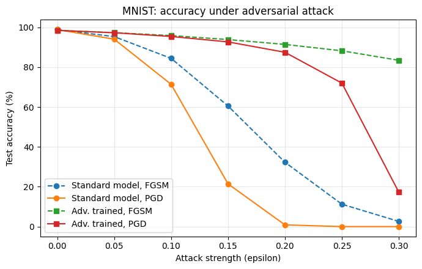
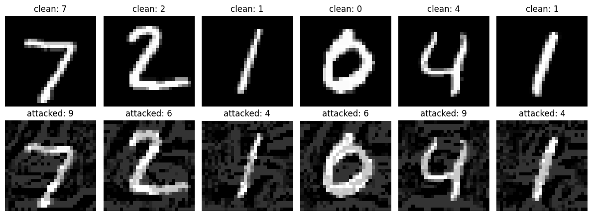

# Adversarial Attacks and Adversarial Training on MNIST

A small study of how easily a neural network image classifier can be fooled by tiny, almost invisible changes to its input, and how much adversarial training helps.

## Problem

Neural networks can reach very high accuracy on clean data, yet a small, carefully chosen perturbation of the input can make them fail. This matters for security-sensitive systems such as face recognition. This project measures:

1. How quickly a standard CNN breaks under FGSM and PGD attacks as the attack strength grows.
2. Whether adversarial training improves robustness, and where that robustness stops.

## Method

- **Dataset:** MNIST (60,000 training images, 10,000 test images). Pixel values are kept in [0, 1], so epsilon is the maximum change per pixel as a fraction of the brightness range.
- **Model:** small CNN (two convolutional layers, two fully connected layers) in PyTorch.
- **Training:** 3 epochs, Adam optimizer (learning rate 1e-3), batch size 128.
- **Attacks (white-box, on the test set):**
  - **FGSM** (Goodfellow et al., 2015): one gradient-sign step of size epsilon.
  - **PGD** (Madry et al., 2018): 10 iterative steps with step size 2.5 x epsilon / 10, random start, and projection back into the epsilon-ball.
- **Defense:** adversarial training. In every batch, PGD examples (epsilon = 0.2, 5 steps) are generated and the model is trained on the clean and the attacked images together.
- **Epsilon values tested:** 0.00, 0.05, 0.10, 0.15, 0.20, 0.25, 0.30.

FGSM and PGD are published methods. I implemented them from scratch and ran all experiments in `adversarial_attack_mnist.py`.

## Results

Test accuracy (%) on the 10,000 MNIST test images:

| Epsilon | Standard, FGSM | Standard, PGD | Adv. trained, FGSM | Adv. trained, PGD |
|---|---|---|---|---|
| 0.00 | 98.83 | 98.83 | 98.45 | 98.45 |
| 0.05 | 95.32 | 94.05 | 97.29 | 97.26 |
| 0.10 | 84.42 | 71.39 | 95.84 | 95.39 |
| 0.15 | 60.51 | 21.44 | 93.84 | 92.67 |
| 0.20 | 32.28 | 0.85 | 91.41 | 87.46 |
| 0.25 | 11.22 | 0.00 | 88.20 | 71.98 |
| 0.30 | 2.60 | 0.00 | 83.43 | 17.27 |

Example of clean digits (top) and the same digits after a PGD attack with epsilon = 0.2 on the standard model (bottom). The model's prediction is shown above each image. All six examples are misclassified, although the digits are still easy for a human to read.

### Observations

- **The standard model is very fragile.** Under PGD, accuracy falls from 98.83% to 0.85% at epsilon = 0.2 and to 0.00% at epsilon = 0.25 and above.
- **Adversarial training helps a lot.** At epsilon = 0.2, PGD accuracy rises from 0.85% to 87.46%, at a cost of about 0.4 percentage points of clean accuracy (98.83% to 98.45%).
- **FGSM overestimates robustness.** At epsilon = 0.3, the adversarially trained model keeps 83.43% accuracy under FGSM but only 17.27% under PGD. A weak attack alone would have given a misleading picture, which is why stronger attacks are needed to evaluate defenses.
- **Robustness is limited to the training strength.** The defended model was trained with epsilon = 0.2 and degrades quickly beyond it (71.98% at 0.25, 17.27% at 0.30).

## Limitations

- Single run with one random seed, so no confidence intervals.
- MNIST is a simple dataset; results may not transfer to harder datasets such as CIFAR-10.
- Only white-box FGSM and PGD (10 steps) were tested. Stronger or different attacks (more PGD steps and restarts, AutoAttack, black-box or transfer attacks) could reduce the robustness reported here.
- The robust model was trained at a single epsilon (0.2), so the behavior at other training strengths is untested.
- Robustness was measured only against the attacks listed above, so it is not a guarantee of security.

## Future work

- Repeat the experiments on CIFAR-10.
- Train robust models at several epsilon values and compare.
- Test transferability: attacks crafted on one model applied to another.
- Compare adversarial training with other defenses, and evaluate with stronger attacks.

## How to run

1. Open `adversarial_attack_mnist.py` in Google Colab (optionally with a GPU runtime).
2. Run the cells in order. MNIST is downloaded automatically.
3. The script saves `accuracy_vs_epsilon.png` and `adversarial_examples.png`.

Requirements: Python 3, PyTorch, torchvision, matplotlib.

## References

- Goodfellow, Shlens, Szegedy. *Explaining and Harnessing Adversarial Examples.* ICLR 2015.
- Madry, Makelov, Schmidt, Tsipras, Vladu. *Towards Deep Learning Models Resistant to Adversarial Attacks.* ICLR 2018.
